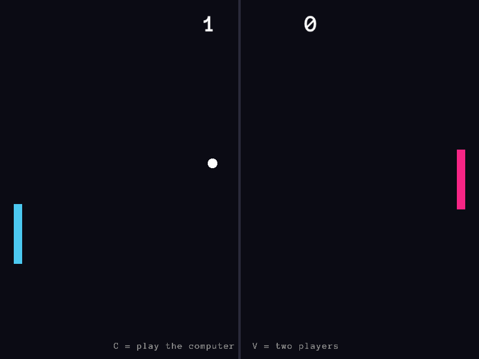
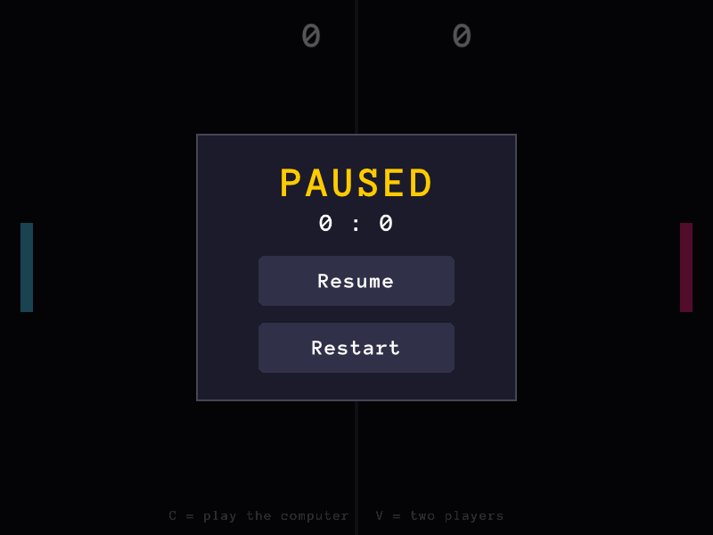
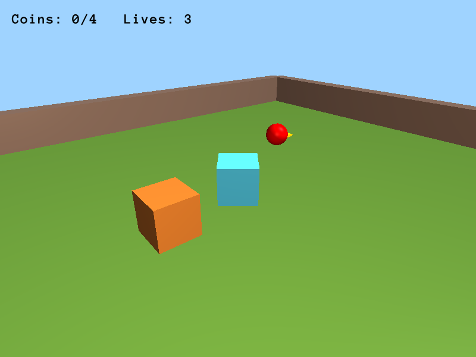
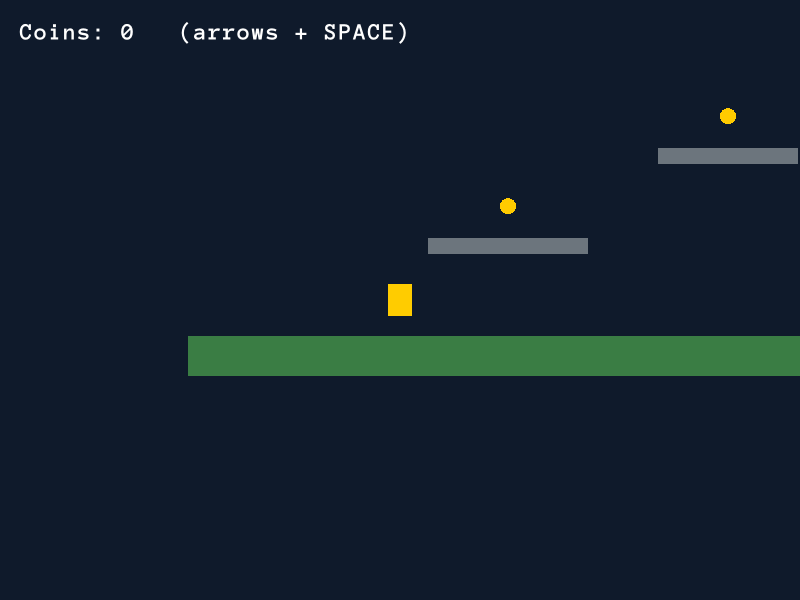

# PimpEx – The Game Engine

<table>
  <tr>
    <td align="center"><br><b>Wolf 3D</b> – <code>examples/wolf3d</code></td>
    <td align="center"><br><b>Pong</b> – <code>examples/pong</code></td>
  </tr>
  <tr>
    <td align="center"><br>Pause menu – <code>gui/pause.xml</code></td>
    <td align="center"><br>The same GUI system in 2D</td>
  </tr>
  <tr>
    <td align="center"><br><code>arena3d</code> scene template</td>
    <td align="center"><br><code>platformer2d</code> scene template</td>
  </tr>
</table>

> **PimpEx** is a game engine for the youngest generation of creators. The
> whole game is text files. There is no GUI editor: what happens "under the
> hood" is visible in the files and can be changed while the game runs.

- **Author:** Tommy · **Started:** 26.03.2026 · **Status:** early development (0.2)

**What you get:**

- **Games as text** – actors in XML, logic in a tiny `.swap` language, behaviors in Lua.
- **Hot-reload everything** – save a file and the running game picks it up between frames.
- **2D and 3D** – shapes, sprites, models, lights, follow/orbit/fps cameras, AABB physics, ASCII tilemaps.
- **GUI by name** – menus, pause screens and buttons in `gui/<name>.xml`, shown with `GUI_SHOW pause`.
- **Ready for AI agents** – an MCP server, a live JSON-RPC API and headless runs with scripted input.

## Quick start

```
pimpex init my_game     # a new project with a ready mini-game
pimpex dev my_game      # the game in a window + hot-reload: save a file → see the change
```

Or play the examples: `pimpex dev examples/wolf3d`, `pimpex dev examples/pong`.

## How it works

A game has five layers. None of them needs the engine to be compiled:

| Layer             | File                          | What it describes                                           |
|-------------------|-------------------------------|-------------------------------------------------------------|
| **Actors (ECS)**  | `scenes/<scene>/scene.xml`    | GameObjects = a name + components (looks, movement, collisions, camera, light, data) |
| **Data**          | `components.xml`              | your own components, e.g. `Health` with an `hp` field       |
| **Scene process** | `scenes/<scene>/scene.swap`   | procedures (`PROC`) run every frame, forever                |
| **Behaviors**     | `scripts/behaviors/*.lua`, `scripts/*.lua` | Lua: `<Behavior>` on actors, `system()`, functions for `CALL` |
| **GUI**           | `gui/<name>.xml`              | menus, pause, buttons – turned on by name: `GUI_SHOW pause` |

```xml
<!-- scene.xml -->
<Actor name="Ghost" x="400" y="300" tags="enemy">
  <Circle color="pink"/>
  <Collider kind="trigger"/>
  <Health hp="3"/>
  <Behavior name="chase" target="Player" speed="1.5"/>
</Actor>
```

```
# scene.swap – a system for all enemies
PROC enemies FOR @enemy
  IF TOUCH SELF Player : ADD Game.lives -1
  IF SELF.Health.hp <= 0 : DESTROY SELF
END
```

### 2D and 3D scenes

`<Scene mode="3d">` turns on 3D. There are shapes (`Cube`, `Sphere`,
`Cylinder`, `Plane`), `.glb`/`.obj` models, lights (`Light`), cameras
(`fixed`, `follow`, `orbit`, `fps`) and AABB physics with gravity. 2D has
shapes, images, a follow camera and a HUD (`space="screen"`). A ready scene
is one command away:

```
pimpex scene new level2 --template platformer2d   # empty2d, topdown2d, platformer2d, empty3d, arena3d, starter2d
```

### GUI: menus and pause by name

Every `gui/<name>.xml` file is a GUI scene with panels, labels, images and
buttons, drawn on top of the game. Buttons run `.swap` instructions:

```xml
<!-- gui/pause.xml -->
<Gui pause="true" dim="#00000099">
  <Label  anchor="center" y="-80" text="Paused" size="44"/>
  <Button anchor="center" text="Resume" key="ESCAPE" click="GUI_HIDE pause"/>
  <Button anchor="center" y="70" text="Menu" click="SCENE menu"/>
</Gui>
```

`GUI_SHOW pause` in `.swap`, `gui.show("pause")` in Lua or
`<Scene gui="hud">` shows a GUI, and `pause="true"` stops the game while the
GUI is visible (docs/gui.md).

### A scene is an endless opcode process

`scene.swap` is the scene loop program that runs for the whole game.
Procedures can be **pasted in and cut out while the game runs**:

- a person or an AI agent appends `PROC ... END` and saves the file, and the
  engine swaps the program between frames;
- `PROC name ONCE` runs once and then the engine removes it from the file;
- `PROC_ADD name` (or `swap.add()` in Lua) pastes a ready procedure from
  `library.swap`, and `PROC_REMOVE` cuts it out.

**Boot** manages all of these changes. It holds the scene data in memory (the
EnTT world, the program, the library, the Lua state, the GUI) and is the only
one that writes `.swap` files: atomically, without touching comments or the
rest of the file. If a file has an error, the game keeps running the previous
version and the error, with its line number, goes to `.pimpex/runtime.log`.

### Threads and the frame

```
asset thread:  FileWatcher → parsing (.swap / XML / Lua / GUI) → Mailbox
API thread:    HTTP JSON-RPC (127.0.0.1) → Mailbox
main thread:   Mailboxes → Boot → GUI clicks → .swap (VM) → Lua behaviors and systems → physics → on_touch → render
```

Data and API commands are always swapped **between frames**, so nothing
changes under your feet during a frame.

## Commands

| Command                                        | What it does                                              |
|------------------------------------------------|-----------------------------------------------------------|
| `pimpex init <name> [--template t]`            | a new project (with `.mcp.json`, `AGENTS.md`, docs and behaviors) |
| `pimpex scene new <name> [--template t]`       | a new scene from a template; `pimpex scene list` – templates |
| `pimpex check [project]`                       | checks XML, `.swap`, Lua, components and GUI (`file:line: error: message`) |
| `pimpex components [project] [--markdown]`     | every component and its fields                            |
| `pimpex dev [project]`                         | the game with hot-reload and the live API                 |
| `pimpex play [project]`                        | just the game (`.swap` changes stay in memory)            |
| `pimpex build [project] [--out dist]`          | a package: engine + game + `play.sh`                      |
| `pimpex mcp [project]`                         | an MCP server for AI agents                               |

`dev` and `play` options:

- `--scene name` – the start scene;
- `--headless` – logic only, no window (with `--frames N`; `dev --headless`
  runs until `quit`);
- `--input "RIGHT:0-60 SPACE:10 CLICK@400/300:20"` – scripted keys and clicks;
- `--screenshot shot.png` – a screenshot of the last frame;
- `--no-api` / `--api` – the live API.

## AI agents

PimpEx has no built-in model. Instead every project is ready for an agent:

- **`.mcp.json`** – Claude Code (and other MCP clients) get the tools
  `pimpex_check`, `pimpex_run`, `pimpex_docs`, `pimpex_scene_new` and `live_*`
  for the running game: state, actor fields, pasting procedures, keys,
  screenshots, Lua;
- **the live API** – JSON-RPC on `127.0.0.1` (port and token in
  `.pimpex/api.json`) for scripts and your own tools (docs/api.md);
- **`AGENTS.md` / `CLAUDE.md`** – the project map, the work loop, the rules;
- **the check loop** – `check` → `play --headless --input` →
  `state.txt` / `runtime.log` → `--screenshot`.

Try: `pimpex init game --template arena3d && cd game && claude "add a third enemy that patrols along a wall"`.

## Documentation

- [docs/opcodes.md](docs/opcodes.md) – the `.swap` language
- [docs/scene-xml.md](docs/scene-xml.md) – `pimpex.xml` and `scene.xml`
- [docs/lua-api.md](docs/lua-api.md) – the Lua scripting API
- [docs/components.md](docs/components.md) – ECS components (generated from code)
- [docs/behaviors.md](docs/behaviors.md) – behaviors and systems
- [docs/gui.md](docs/gui.md) – GUI: menus, pause, buttons
- [docs/api.md](docs/api.md) – the live API and the MCP server
- [examples/pong](examples/pong) – Pong: two scenes, a pause menu, a computer player pasted from the library
- [examples/wolf3d](examples/wolf3d) – Wolf 3D: an ASCII map, guards with sight (raycasts), doors, pickups

## Building the engine

Requirements: CMake ≥ 3.28, Ninja, a C++23 compiler (GCC 14+ / Clang 18+),
[vcpkg](https://vcpkg.io) (in `$VCPKG_ROOT` or `~/vcpkg`).

```
cmake --preset linux-debug
cmake --build build
ctest --test-dir build --output-on-failure
./build/pimpex dev examples/pong
```

Dependencies (vcpkg): raylib (+ GLFW), EnTT, pugixml, Lua + sol2, CLI11,
cpp-httplib, nlohmann-json, doctest. Font: Anonymous Pro (SIL OFL,
`third_party/fonts/`).

## Repository layout

```
engine/core     Engine (the loop), Log, Mailbox, Diagnostic
engine/boot     Boot, XML loading, SwapFile, FileWatcher, pimpex check
engine/vm       Lexer, Parser, Program, VM, keys and input
engine/scene    ComponentRegistry, components, World (EnTT), physics, component docs
engine/script   Lua (sol2): runtime, behaviors, systems, script checking
engine/gui      GUI scenes: elements, anchored layout, GuiSystem – show by name, clicks
engine/render   raylib: 2D/3D renderer, GUI, lighting shader, font, RaylibInput
engine/api      the live API (JSON-RPC/HTTP) and the MCP server
engine/cli      CLI commands (Command pattern) + templates
apps/pimpex     main()
templates/      templates: project, scenes, behavior library
docs/           specifications (also copied into every project)
examples/       example games
tests/          doctest tests + end-to-end tests in ctest
```
