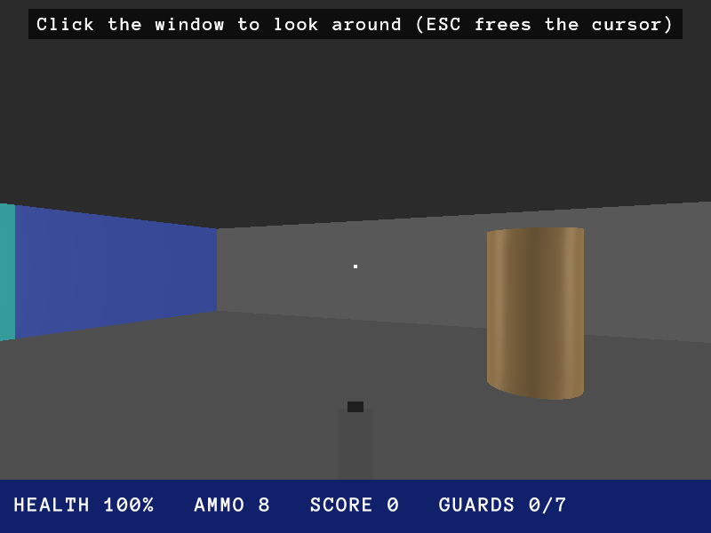
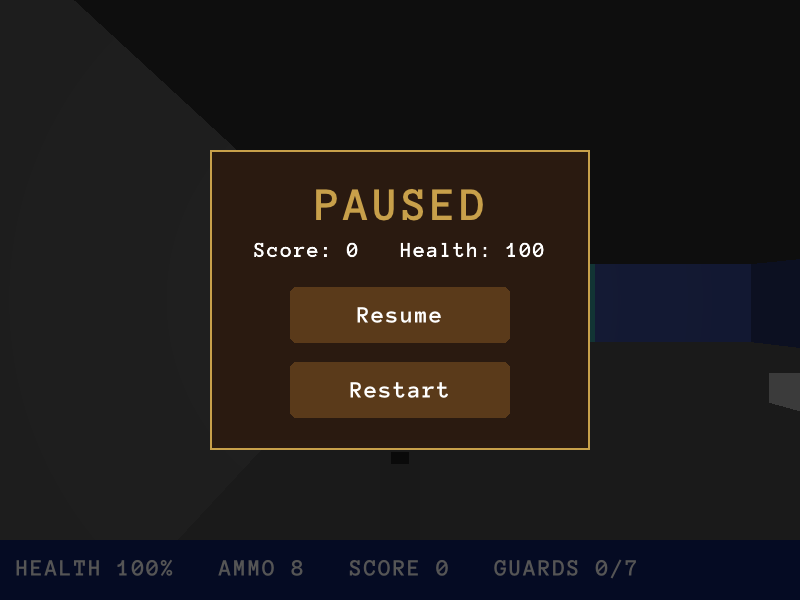

# Wolf 3D on PimpEx

A simple Wolfenstein 3D clone: one level, 7 guards, doors, medkits, ammo,
treasure and a lift (the green square) at the end.

```
pimpex dev examples/wolf3d
```

| In the game | The pause menu |
|:---:|:---:|
|  |  |

| Key                       | Action                         |
|---------------------------|--------------------------------|
| up/down arrows, W/S       | forward / back                 |
| left/right arrows, mouse  | turn                           |
| A / D                     | strafe                         |
| SHIFT                     | run                            |
| SPACE                     | shoot                          |
| E                         | open doors                     |
| click the window          | mouse look (the cursor starts free) |
| ESC                       | pause (`gui/pause.xml`) and a free cursor |
| 9 / 8                     | cheats: god mode / ammo (from `library.swap`) |

## How it is made

- **The level** is an ASCII map in `scenes/level1/scene.xml` (`<Tilemap>`). `#`
  and `B` are walls, `D` doors, `G` guards, `+` medkits, `a` ammo, `$`
  treasure, `E` the lift, `P` the player. Change the map and save – the game
  reloads it.
- **The player** (`scripts/behaviors/wolf_player.lua`) moves through velocity
  (`Body`), so walls with a `Collider` stop it. It shoots a ray:
  `self:look(40)` returns the first actor hit.
- **Guards** (`guard.lua`) look with `self:sees("Player")`, so walls block the
  view. They hear shots within 14 m, walk over, turn (`self:face`) and shoot.
  A dead guard leaves a body and ammo.
- **Doors** (`door.lua`) slide into the ceiling when E is pressed and remove
  their `Collider` while open.
- **The HUD and the end of the game** are plain `.swap` procedures in
  `scenes/level1/scene.swap`; the pause and end menus are in `gui/`.
